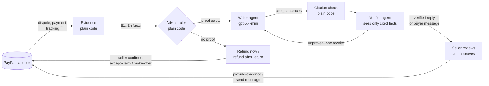

# Dispute Copilot

**AI that answers PayPal disputes for small sellers, where every sentence links to its proof.**

[](https://github.com/KumarPadigeri/paypal-dispute-copilot/actions/workflows/ci.yml)
· **Live demo: https://dispute-copilot-zi8a.onrender.com/** · **[Demo video](https://youtu.be/ICAm8-CtHpg)** · Built for the
[PayPal AI Hackathon 2026](https://paypalaihackathon.devpost.com/) · PayPal sandbox only


## The problem

When a buyer opens a PayPal dispute, the seller has a deadline to answer with proof. Small
sellers often lose cases they should win: the proof (payment, order, tracking) sits on
different screens, the deadline passes, or the reply is vague or angry. Generic AI writing
tools make this riskier, not safer: one invented sentence ("the item was delivered") can
lose the case. Across card payments, merchants simply accept about 46% of chargebacks without a
fight, and win only about one in five of the ones they do fight ([Mastercard's 2025 State of
Chargebacks](https://www.chargebackgurus.com/blog/chargeback-stats-and-insights-from-mastercards-state-of-chargebacks-report),
as summarised by Chargeback Gurus). PayPal disputes have the same shape: a deadline, proof
spread over several screens, and a seller without time.

## What Dispute Copilot does

1. **Gathers the evidence from PayPal**: the payment, the items, Seller Protection status and
   shipment tracking, as numbered facts (E1, E2, …).
2. **Writes a calm reply** (Writer agent) that answers the buyer's own claims (C1, C2, …),
   where every sentence cites the facts it rests on.
3. **Checks every sentence** (Verifier agent) against *only* the evidence it cites. A
   sentence that says more than its proof ("shipped *before* the case was opened") goes back
   to the Writer once; if it is still unproven, it is removed and shown to the seller.
4. **Knows when not to fight.** No tracking on an "item not received" case, or no proof of
   what was shipped on a "not as described" case: it says so and offers a fair way out
   (refund now, or refund after return) instead of drafting an argument it cannot back up.
5. **Messages the buyer too.** A short note to the buyer ("your order shipped via USPS,
   tracking 9400…"), written and verified the same way: every sentence cites PayPal
   evidence. It is offered only where the evidence can actually help the buyer.
6. **The seller approves.** Nothing reaches PayPal or the buyer until the seller clicks, and
   only the last *verified* reply or message can be sent.
7. **Two conversations on every case.** *With PayPal* (what it asked for, what you sent, what
   it decided) and *With the buyer* (messages and offers), built from PayPal's own records, each
   with its composer at the bottom. A plain-code check says up front whether PayPal's records
   hold what it asks for, and a live stepper shows the agents at work.
8. **An inbox built for the deadline.** Every case that needs a reply shows its reply-by date
   in the seller's own time zone (amber at 5 days, red at 2), and the case panel shows the
   dispute's stage (Inquiry → Claim → Closed).
9. **Insights.** Two charts a merchant acts on: *money at stake by reply deadline* and *money
   by dispute reason*. Click a bar (or the link under it) to open exactly those disputes.

## For judges: a 2-minute tour

1. Open the **[live demo](https://dispute-copilot-zi8a.onrender.com/)**. It runs on Render's
   free plan: if it has been idle, the first load can take about a minute.
2. The inbox opens on cards; the list icon beside the status chips switches to the **grid** (AG Grid:
   sort any column, drag, resize or hide columns, type in the filter row, pick dates from a
   calendar, watch the totals row follow, export what you see as CSV). The **Insights** tab opens the charts.
3. Click the **$49.99** case (`PP-R-FOD-10194708`), then **Draft reply**. Without a PIN you see
   a **replay of a real run**: the agent timeline, the Verifier's verdicts, the final reply.
   Point at a sentence to light up the evidence it cites. The **With the buyer** tab's
   **Draft message** replays a real, verified note to the buyer.
4. Look at the other cases: one was **refunded** and one got a **return offer**, both sent
   from this app through PayPal's dispute API.
5. **Live AI and sending:** click *Have a demo PIN? Unlock live AI* and use the PIN from the
   Devpost submission's private testing notes. Drafting then calls the real model, and
   *Approve & send* posts the evidence (or the message) to the PayPal sandbox.

Everything is sandbox money and made-up customers. No real personal data is used.

## How it works



The rules that keep it honest:

- **Facts come from PayPal and code; the AI only writes and checks.** Date comparisons
  ("the shipment and the case opening are both dated Oct 27, 2026") are computed by code and
  given to the Writer as evidence, so it never has to infer them.
- **Buyer statements are claims, never proof.** They are answered, not cited.
- **Money-moving actions use fixed text written in code**, never AI text, and need the
  seller's confirmation.
- **Only verified text can be sent**: the server keeps the last verified reply (and, apart,
  the last verified buyer message) and sends exactly that, once.
- **Public demo costs nothing**: without the PIN, drafting replays a recorded real run and can
  never be sent; with the PIN, live drafts are capped per day.

## How PayPal is used

Reads go through **PayPal's Agent Toolkit** (`paypal-agent-toolkit`): its dispute and
shipment-tracking handlers list disputes, open one, and fetch its tracking, on a sandbox-only
client. The actions the toolkit does not cover (or not in the shape a seller needs: refunding
with `REFUND`, offering a refund after return, sending evidence, messaging the buyer) are
direct REST calls.

| PayPal API (sandbox) | Used for |
|---|---|
| `POST /v1/oauth2/token` | App authentication |
| `GET /v1/customer/disputes`, `GET /v1/customer/disputes/{id}` (Agent Toolkit) | Dispute list, case details, buyer messages, what PayPal asks for, stage, reply-by date |
| `GET /v1/shipping/trackers` (Agent Toolkit) | Shipment tracking as evidence |
| `POST /v1/customer/disputes/{id}/provide-evidence` | Sending the verified reply with proof of fulfillment |
| `POST /v1/customer/disputes/{id}/send-message` | Sending the verified message to the buyer |
| `POST /v1/customer/disputes/{id}/accept-claim` | "Refund the buyer now" |
| `POST /v1/customer/disputes/{id}/make-offer` | "Offer refund after return" |
| `POST /v1/shipping/trackers-batch` | Demo setup only (`scripts/add_tracking.py`): attach a tracking number like a seller would |

## How AI is used

- **Microsoft Agent Framework** runs two agents on **Gemini 3.5 Flash-Lite** through the Gemini API.
  The Writer has two briefs: a reply to PayPal's reviewer, or a message to the buyer.
- The **Writer** returns structured output (each sentence with the evidence ids it cites and
  the buyer claims it answers), so plain code can check every citation.
- The **Verifier** gets each sentence with only its cited evidence and returns a verdict and a
  reason per sentence. The loop (write, check, verify, one rewrite, remove) is plain code.

## Sponsor tools

- **AG Grid (Community)**: the dispute grid. Sorting, column resize and reorder (remembered),
  a filter row (contains-text, dropdowns for status and PayPal's reasons, calendar pickers for
  dates, a clear button per filter and *clear all*), quick search, a pinned case column, and
  CSV export of exactly what is on screen.
- **AG Charts (Community)**: the Insights charts, drawn in the app's colours in light and dark,
  with click-through to the filtered inbox.
- **Render**: the live demo. A Blueprint (`render.yaml`) builds the Docker image on every push
  to `main`, with secrets kept as Render environment variables.
- **Postman**: [`docs/postman`](docs/postman) has a collection of the whole API with a test on
  every request (checked with newman).

## Accessibility

WCAG 2.2 AA is checked automatically: axe-core runs in the browser tests on cards, the grid, a
case, the refund advice and Insights, in light and dark. Keyboard use (tab order, visible
focus, Esc, splitter arrow keys), 200% zoom and reduced motion are checked by hand. Charts are
one labelled image each, with the same numbers as links underneath. One finding is allowed in
the tests and documented there: AG Grid's own layout wrappers inside its grid.

## Tech stack

Python 3.11, FastAPI with server-sent events · PayPal Agent Toolkit · Microsoft Agent
Framework, Gemini API (gemini-3.5-flash-lite) · React, TypeScript, Vite · AG Grid, AG Charts,
react-day-picker, Inter · pytest, Playwright, axe-core, ruff, ESLint · GitHub Actions · Docker on
Render. The grid and charts load only when first shown (first page load about 80 kB gzipped).

## Run it yourself

You need a PayPal developer account (free sandbox app), a Gemini API key from
[Google AI Studio](https://aistudio.google.com/apikey), Python 3.11 and Node 20.

```bash
cp .env.example .env            # fill in PayPal sandbox credentials and GOOGLE_API_KEY
python3.11 -m venv .venv && .venv/bin/pip install -r requirements-dev.txt
.venv/bin/pip install --no-deps -r requirements-toolkit.txt   # PayPal Agent Toolkit, without its
                                                               # LangChain/CrewAI extras we don't use
npm --prefix web ci

.venv/bin/uvicorn copilot.api:app --reload    # API on http://localhost:8000
npm --prefix web run dev                       # UI on http://localhost:5173
```

Leave `DEMO_PIN` empty locally and everything is live. Test disputes are created in the PayPal
sandbox website as the buyer (pay by card, then *Report a problem*); add tracking with
`.venv/bin/python -m scripts.add_tracking <seller transaction id> <tracking number>`.

**Tests:** `.venv/bin/pytest` (unit, no network) and, after `npm --prefix web run build`,
`.venv/bin/pytest -m e2e` (browser tests against a fake PayPal made from saved sandbox data).
CI runs both on every push.

## Project layout

```
copilot/        evidence.py (facts from PayPal) · advice.py (when not to fight)
                writer.py · verifier.py · pipeline.py (the loop) · submit.py (what is sent)
                api.py (FastAPI + SSE) · demo.py (PIN, daily cap, replay) · paypal_client.py
web/            React UI: cards and AG Grid inbox, case panel, live draft, approve and send,
                Insights (AG Charts) · lazy-loaded grid and charts
tests/          unit tests · e2e/ browser tests with a fake PayPal
scripts/        add_tracking.py · record_replay.py · screenshots.py
docs/postman/   Postman collection of the API
```

## Honest limitations

- **Sandbox only.** Test disputes are opened through the sandbox website, because PayPal's
  buyer-side dispute API needs partner permissions.
- **One server instance**: the verified-reply store and daily cap live in memory, which suits a
  single free Render instance, not a fleet.
- **English, US dollars**, and the two most common dispute reasons so far.

## License

[MIT](LICENSE)
